# Post-contenido — Unidad 6: JSP con MVC

## Descripción

Repositorio del laboratorio de la Unidad 6 de Programación Web — Séptimo
Semestre. Contiene un único proyecto Maven Web (`gestor-tareas-mvc`, en la raíz
del repositorio) que formaliza el patrón MVC con un **Front Controller** y el
**patrón Comando**, extendido con autenticación por sesión con roles,
validación por campo e internacionalización (i18n).

**Estudiante:** Neidys Mariana Quintero Carrillo

## Prerrequisitos

- JDK 17 o superior en el PATH
- Apache Tomcat 10.x (Jakarta EE 10), puerto 8080 libre
- Maven 3.8+ (integrado en IntelliJ IDEA o instalado globalmente)
- IntelliJ IDEA (recomendado) o Eclipse for Enterprise Java Developers

## Tecnologías usadas

Jakarta Servlet 6.0, JSP 3.1 con EL y JSTL 3.0 (`c:`, `fmt:`), sin
scriptlets; `HttpSession`, `Cookie`, `ServletContext` (`context-param`) y
`ResourceBundle` (`messages*.properties`); Maven (empaquetado `war`); Git.

## Estructura del proyecto

```
quintero-post1-u6/
├── pom.xml
├── README.md
├── capturas/
│   ├── parte-1/
│   └── parte-2/
└── src/main/
    ├── java/com/ejemplo/mvc/
    │   ├── model/
    │   │   ├── Tarea.java, TareaDAO.java            ← Modelo y acceso a datos
    │   │   └── Usuario.java, UsuarioDAO.java        ← (Parte 2)
    │   ├── service/
    │   │   ├── TareaService.java                    ← Lógica de negocio
    │   │   └── AutenticacionService.java            ← (Parte 2)
    │   └── controller/
    │       ├── FrontControllerServlet.java          ← Único punto de entrada (/app)
    │       └── comando/
    │           ├── Comando.java                     ← Interfaz común
    │           ├── ListarComando, FormularioComando, GuardarComando,
    │           │   EliminarComando, CompletarComando
    │           └── LoginComando, LogoutComando, IdiomaComando   ← (Parte 2)
    ├── resources/
    │   ├── messages.properties                      ← inglés (por defecto)
    │   └── messages_es.properties                   ← español
    └── webapp/
        ├── index.jsp                                ← c:redirect a /app
        ├── css/estilos.css
        └── WEB-INF/
            ├── web.xml                              ← context-param de la aplicación
            └── views/
                ├── lista.jsp, formulario.jsp
                ├── login.jsp                        ← (Parte 2)
                └── idioma.jspf                      ← fragmento de locale + bundle
```

## Parte 1 — Front Controller y patrón Comando

`FrontControllerServlet` es el único punto de entrada (`/app`) y delega en
objetos Comando (`ListarComando`, `FormularioComando`, `GuardarComando`,
`EliminarComando`, `CompletarComando`) registrados en un mapa
`nombre → Comando`. Si la URL no trae `comando`, se usa `listar`; un comando
desconocido responde `404`. `TareaService` (lógica de negocio) y `TareaDAO`
(acceso a datos en memoria) separan el Modelo del Controlador: ningún Comando
toca el DAO directamente. En `init()` el Front Controller lee los
`context-param` de `web.xml` (`app.nombre`, `app.maxLongitudTitulo`) y los
publica en `applicationScope`. Las vistas usan JSTL y Expression Language,
sin scriptlets (incluso `index.jsp` usa `<c:redirect>`). Las acciones que
modifican datos terminan en `sendRedirect` a `/app?comando=listar` (PRG).

## Parte 2 — Sesión con roles, validación por campo e i18n

`FrontControllerServlet` centraliza la **verificación de sesión** antes de
resolver cualquier comando protegido (todos excepto `login` e `idioma`).
`LoginComando`/`LogoutComando` gestionan `HttpSession` con roles
`ADMIN`/`USER` (al iniciar sesión se descarta la sesión anónima previa);
`EliminarComando` solo permite el rol `ADMIN`. `GuardarComando` valida cada
campo por separado (título obligatorio y con longitud máxima leída del
contexto de aplicación, categoría obligatoria, prioridad dentro de
Alta/Media/Baja, fecha con formato `yyyy-MM-dd` estricto y no anterior a hoy),
acumula los mensajes en un `Map<String,String>`, muestra cada error junto a su
campo y repuebla lo ya escrito. `IdiomaComando` guarda la preferencia de
idioma en una **Cookie** de 30 días, que las vistas leen con el objeto EL
implícito `cookie` para fijar el locale del `ResourceBundle`
(`messages.properties` / `messages_es.properties`).

Usuarios de prueba:

| Usuario | Contraseña   | Rol   |
|---------|--------------|-------|
| `admin` | `Admin123!`  | ADMIN |
| `maria` | `Maria2026!` | USER  |

## Decisiones de diseño

### El Comando devuelve la vista lógica, no hace el forward

Cada Comando devuelve la ruta de la vista (o `null` si ya resolvió la
respuesta con `sendRedirect`), pero ninguno llama a
`RequestDispatcher.forward`. Esa llamada vive en un solo lugar:
`FrontControllerServlet.procesar()`. Si cada Comando hiciera su propio forward,
el mismo código se repetiría en todos ellos y el Front Controller perdería la
oportunidad de aplicar lógica común antes o después de cualquier comando, que
es justo lo que se necesitó en la Parte 2.

### Front Controller en vez de un Servlet por acción

En la Unidad 5 las operaciones se resolvían con ramas `if` dentro de
`TareasServlet` y con un segundo Servlet independiente para el detalle. Aquí
un único punto de entrada (`/app`) enruta hacia objetos Comando. La ventaja no
es solo de orden: como **toda** petición pasa por `procesar()`, la lógica
transversal se escribe una sola vez. Agregar una operación nueva es agregar
una clase Comando y una línea en el mapa de `init()`.

### Verificación de sesión centralizada en el Front Controller

El chequeo de sesión se agregó en `procesar()`, antes de buscar el comando, y
no dentro de cada Comando. Con "un Servlet por acción" habría que copiar el
mismo bloque `if` al inicio de cada Servlet, con el riesgo de olvidarlo en
alguno. Así, cualquier comando nuevo queda protegido automáticamente; solo
los que están en el conjunto `PUBLICOS` (`login`, `idioma`) se saltan el
chequeo. La captura `parte-2/chk01.png` muestra el `302` de
`?comando=listar` hacia `?comando=login` sin sesión.

### Idioma en Cookie, usuario y rol en HttpSession

El usuario autenticado y su rol viven en `HttpSession` porque deben
desaparecer al cerrar sesión o cuando la sesión expira (30 minutos de
inactividad): es una cuestión de seguridad. El idioma es una preferencia, no
un dato de seguridad, y debe **sobrevivir** al cierre de sesión: la próxima
vez que alguien abra la aplicación, incluso la pantalla de login debe salir en
el idioma elegido. Por eso va en una Cookie de 30 días (la tabla comparativa
de la Guía, sección 5.4, la señala como caso típico de Cookie). Las capturas
`parte-2/chk10.png` y `parte-2/chk11.png` muestran que al borrar solo
`JSESSIONID`, o al cerrar sesión, el login aparece en inglés porque la cookie
`idiomaPreferido=en` sigue ahí.

### Validación por campo con mensajes en un mapa

La versión de la Parte 1 solo detectaba el título vacío y se detenía en el
primer error. `GuardarComando` ahora valida **todos** los campos y guarda cada
mensaje en un `LinkedHashMap` con la clave del campo (`titulo`, `categoria`,
`prioridad`, `fechaLimite`). La vista consulta `errores.titulo`,
`errores.fechaLimite`, etc. para marcar en rojo solo el campo afectado y
mostrar su mensaje al lado, y además un resumen arriba. Los valores se
devuelven en el request para repoblar el formulario, de modo que el usuario
corrige solo lo que falló. `LinkedHashMap` conserva el orden del formulario en
el resumen.

### La longitud máxima del título viene del contexto de aplicación

El límite de 80 caracteres no está escrito como literal en `GuardarComando`:
se lee de `req.getServletContext().getAttribute("maxLongitudTitulo")`, que
`FrontControllerServlet` cargó una sola vez en `init()` desde el
`context-param` `app.maxLongitudTitulo` de `web.xml`. Es un dato global e
inmutable compartido por todos los hilos (Guía, sección 6.1): la regla puede
cambiarse editando `web.xml`, sin recompilar, y cualquier otro Comando que lo
necesite lo lee del mismo lugar.

### Otras decisiones

- `TareaDAO` usa `CopyOnWriteArrayList` y `AtomicInteger` porque la lista es
  estado compartido por todos los hilos del contenedor.
- Las JSP usan las URIs `jakarta.tags.core` / `jakarta.tags.fmt`, que son las
  de JSTL 3.0 (la versión del `pom.xml`).
- Los textos escritos por el usuario se imprimen con `<c:out>` para evitar
  inyección de HTML (XSS).
- El locale y el bundle se configuran en un fragmento `idioma.jspf` incluido
  por las tres vistas, para no repetir las dos líneas en cada JSP.
- Las contraseñas están en texto plano solo por simplicidad del laboratorio;
  en producción se guardarían con hash (por ejemplo, BCrypt).

## Cómo compilar y ejecutar

1. Clonar el repositorio:
   `git clone https://github.com/neidys06/quintero-post1-u6.git`
2. Abrir la carpeta como proyecto Maven en IntelliJ IDEA (JDK 17).
3. Ejecutar `mvn clean package` → genera `target/gestor-tareas-mvc.war`.
4. IntelliJ: Run → Edit Configurations → + → Tomcat Server → Local →
   Deployment → agregar `gestor-tareas-mvc:war exploded` con contexto
   `/gestor-tareas-mvc`. (Alternativa: copiar el `.war` a `TOMCAT_HOME/webapps`
   y ejecutar `bin/startup.sh` o `startup.bat`).
5. Abrir `http://localhost:8080/gestor-tareas-mvc/app`.
   - Parte 1 (código del commit "vistas lista.jsp y formulario.jsp…"): el
     listado carga directamente.
   - Parte 2 (versión final): redirige al login; usar `admin`/`Admin123!` o
     `maria`/`Maria2026!`.

## Capturas de pantalla

### Parte 1 — Front Controller y CRUD

**`/app` sin parámetro `comando`: listado con las 3 tareas precargadas**
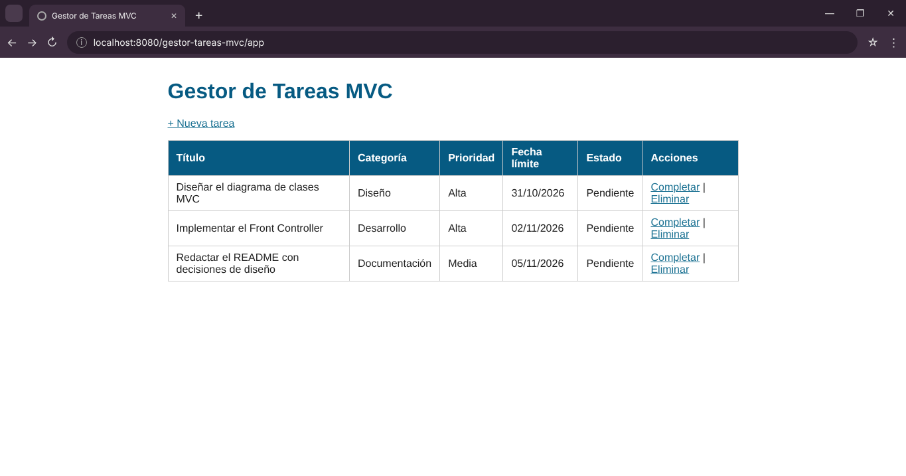

**Formulario "+ Nueva tarea" (`?comando=formulario`)**
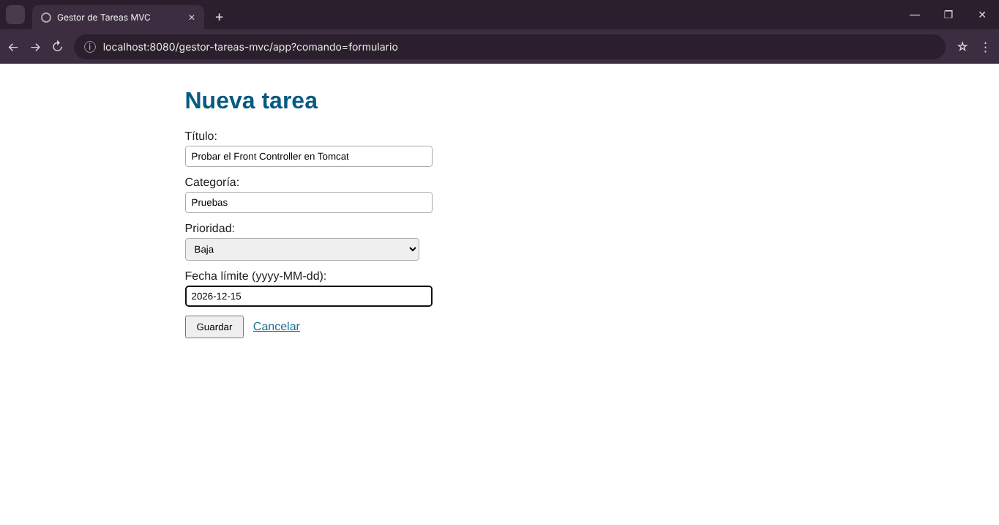

**Guardar: `POST /app` → `302` → `/app?comando=listar` (PRG) con la tarea nueva**


**Completar: la tarea aparece tachada y en estado "Completada"**
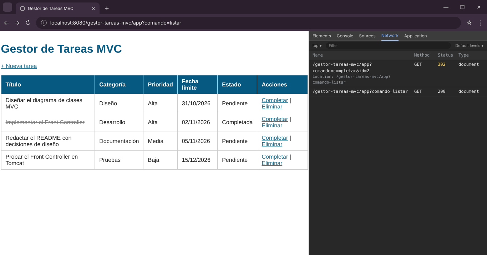

**Eliminar: diálogo de confirmación aceptado y la tarea desaparece**
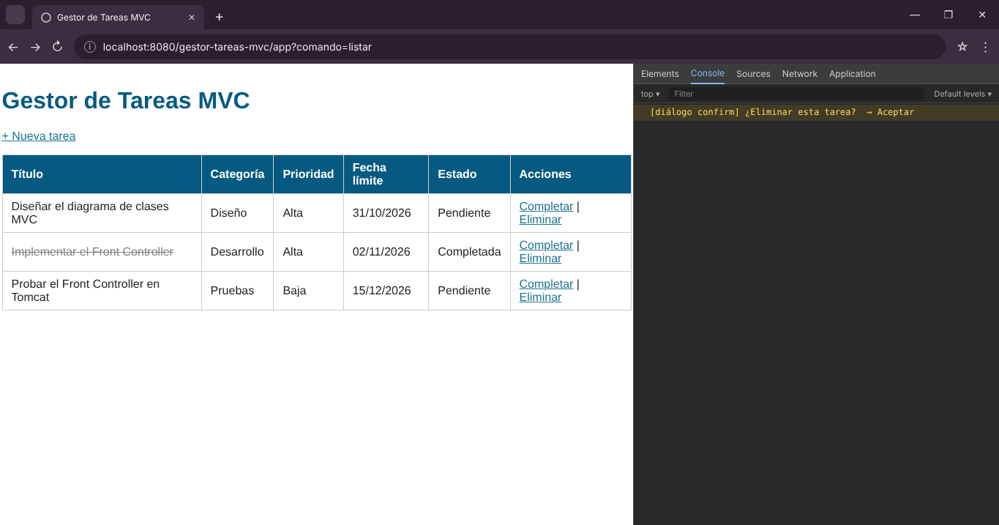

**Log de Tomcat sin `ClassNotFoundException` ni `NullPointerException`**
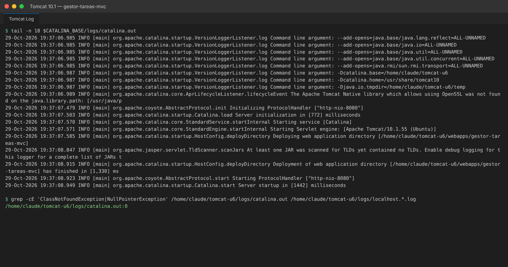

### Parte 2 — Sesión, roles, validación e i18n

**Sin sesión: `?comando=listar` redirige (`302`) a `?comando=login`**
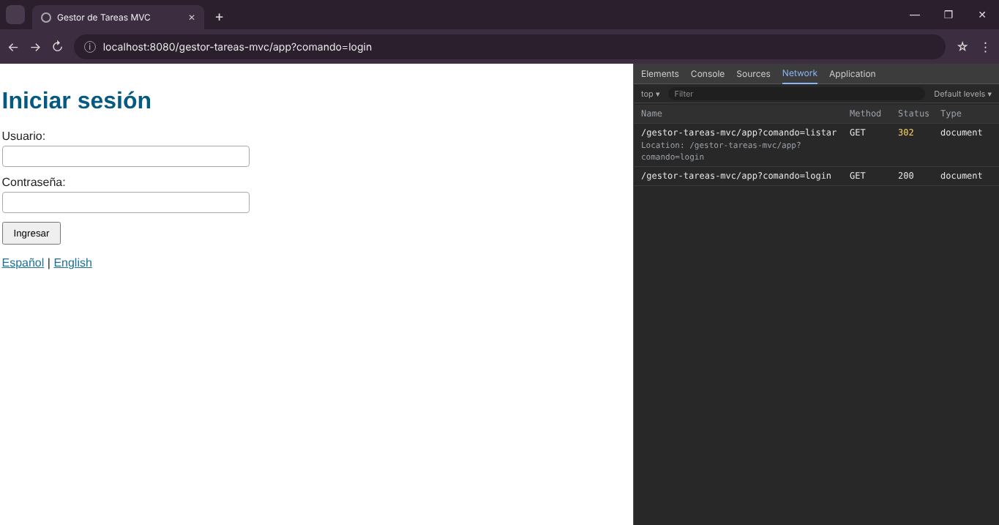

**Credenciales incorrectas: mensaje en la misma página de login**
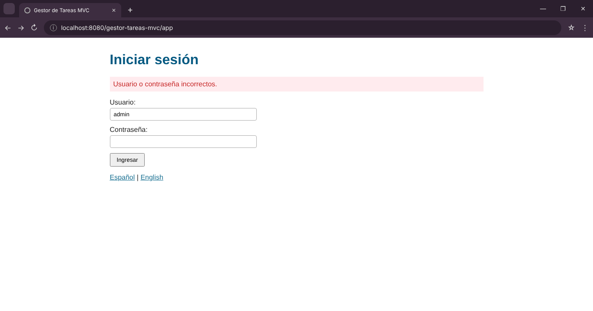

**Login `admin`: saludo con nombre y rol ADMIN (`POST 302` → listado)**
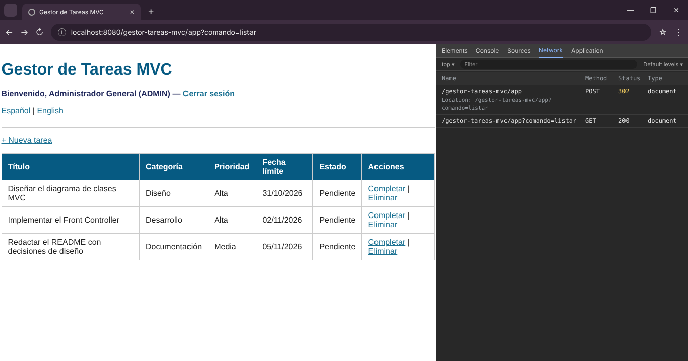

**ADMIN elimina una tarea tras confirmar el diálogo**
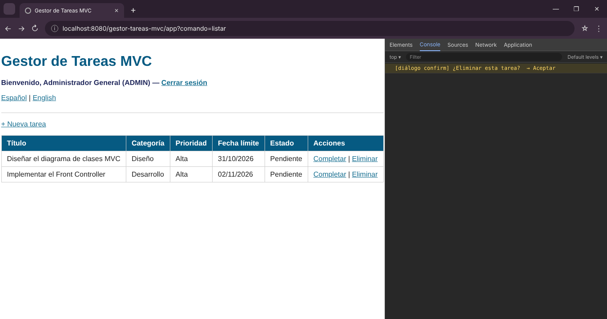

**Login `maria`: saludo con rol USER**
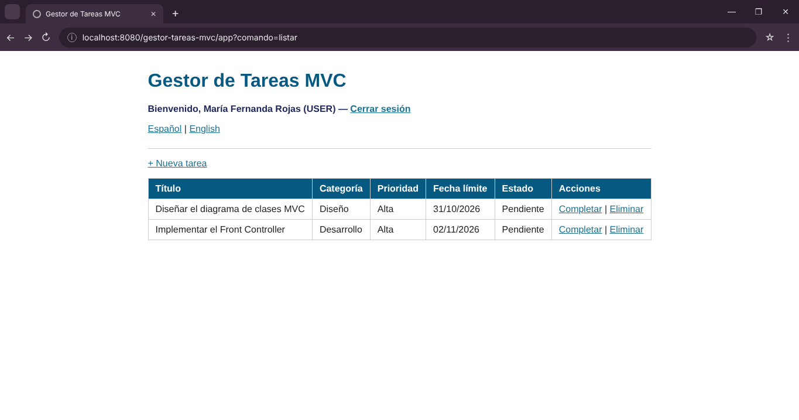

**USER intenta eliminar: mensaje de restricción de rol y la tarea no se elimina**
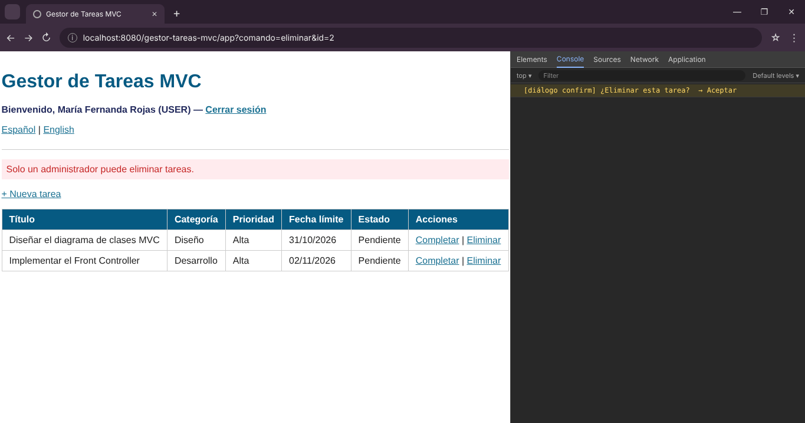

**Título vacío y fecha con formato inválido a la vez: ambos errores junto a su campo; categoría y prioridad repobladas**
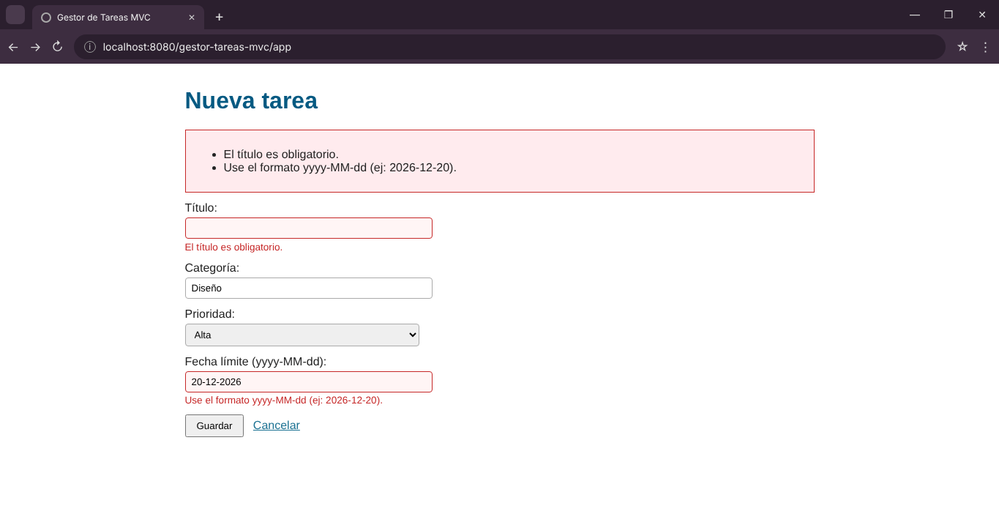

**Título de más de 80 caracteres (límite de `web.xml`), categoría vacía y fecha en el pasado**
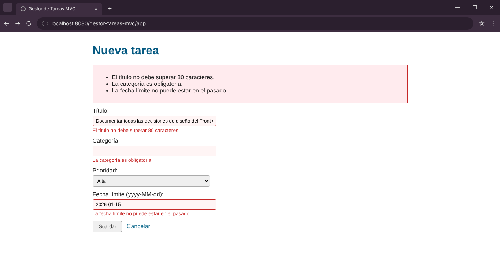

**Clic en "English": encabezados, estados y enlaces en inglés; cookie `idiomaPreferido=en`**
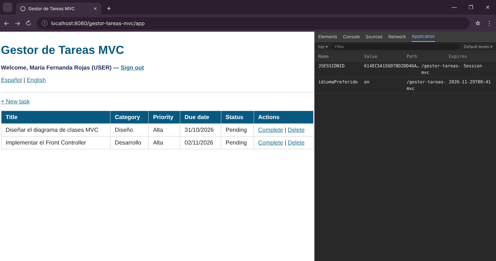

**Se borra solo `JSESSIONID`: la sesión se pierde, pero el login sigue en inglés (la cookie de idioma sobrevive)**
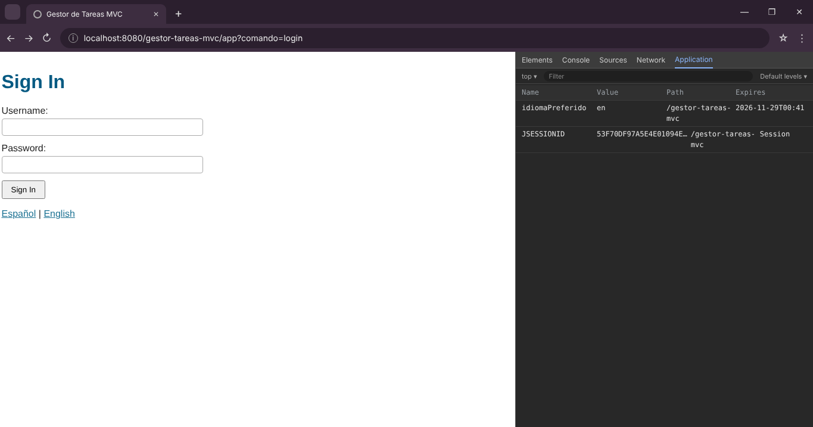

**Tras "Sign out" la sesión se invalida y el login sigue en inglés**


**Clic en "Español": la cookie cambia a `es` y la página vuelve al español**
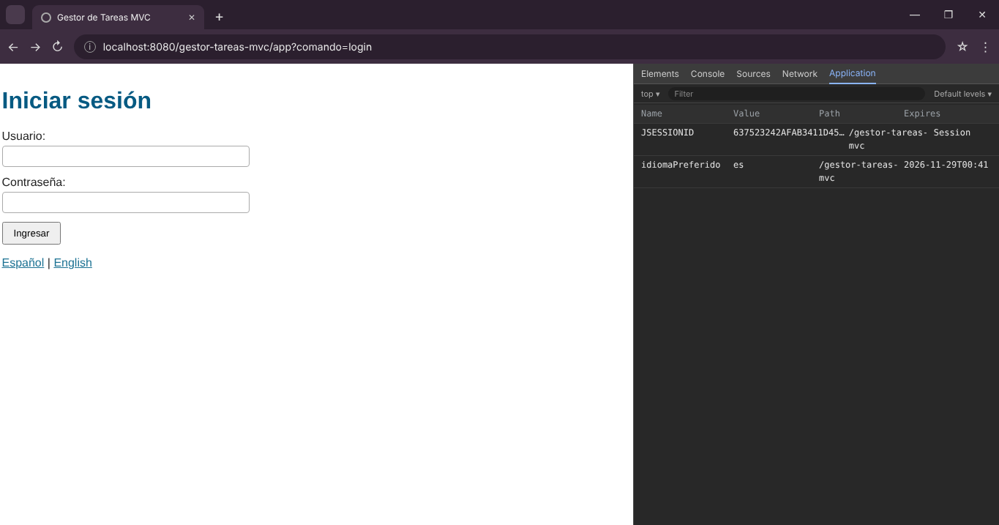
